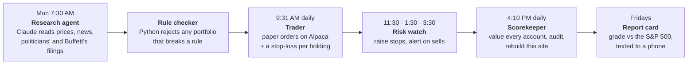

# Breakout Bot Tracker: an AI-run paper-trading portfolio

A school project by Evan Black (finance student). **Claude**, Anthropic's AI, researches the
market every week and decides what a $100,000 **paper-money** portfolio should own. Plain Python
rules check its work, trade it through a real broker API (Alpaca's paper account), protect every
holding with a stop-loss, and score it against the S&P 500, Warren Buffett's Berkshire Hathaway and
US politicians. It runs on autopilot on GitHub's servers.

**Live site:** https://evanblack418-dev.github.io/trading-dashboard/ (password-protected; this
repository holds only the encrypted page). Open the **Behind the scenes** tab to see the agents working.

## How a week runs

## What makes it more than a chatbot

| Piece | What it does |
|---|---|
| **Research agent** | Claude Code running headless in GitHub Actions. Every Monday it writes a ranked portfolio (5–10 stocks, ETFs, bonds, gold) with a dated reason and a risk for each pick. |
| **Rule checker** | Code throws away any AI answer that breaks the rules (max 25% per holding, bonds or gold required, no leverage), so a bad answer never reaches the account. |
| **Safety stops** | Every holding has a trailing stop at its 10-day low: raised, never lowered. A stopped-out stock can only come back after a new 20-day high. |
| **Comparison accounts** | S&P 500 fund, Berkshire's filed holdings, a politicians' ETF, and a simulated copy of disclosed congressional trades. |
| **Aggressive experiment** | A separate simulated account (top 5 by 3-month momentum, no safety net) to test whether more risk actually pays. |
| **Claude Code skills** | `/bot-health`, `/weekly-report`, `/trade-review`, `/market-brief`: commands that let Claude inspect, explain and report on the bot. |

## Guardrails

- Paper money only: the code refuses to start if it sees a live-trading address or key.
- One file may send orders, and it blocks margin, shorting, options, crypto and leveraged funds.
- The bot's records must match the broker's on every run, or it stops trading and sends an alert.
- Every number on the site is audited against the broker before publishing.
- The strategy was frozen before the test began (Oct 2026 to Jan 2027) so the results stay honest; new ideas run only as labeled experiments.
- 100+ automated tests; the published page is AES-encrypted.

## Built with

Claude Code (headless agent and skills) · Python · pandas · GitHub Actions · Alpaca paper-trading API ·
ntfy phone alerts · pytest · hand-written SVG charts.

---

*Simulated results with paper money. Past results do not predict future returns. Not investment advice.*
